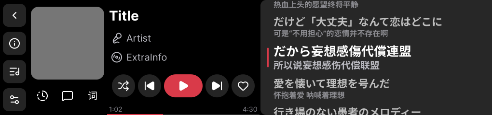

# 播放页（设计稿重做）

2026-10-29 起，播放页按 Figma 设计稿重做：三列横排 = 全局左栏 + 控制区 + 右侧子面板。设计源：[Figma PlayerPage 节点 `14:1570`](https://www.figma.com/design/PtqtSgZYapNBzU9WG91CgR/Untitled?node-id=14-1570)；
控制区右列 2026-10-30 按 [ControlPanel 节点 `13:1335`](https://www.figma.com/design/PtqtSgZYapNBzU9WG91CgR/Untitled?node-id=13-1335) 改为 3:2:2:1.5:5 比例、进度条上移、控制键间距自动拉伸。

> 2026-10-30 调整：左栏样式（60px、48×48 圆角键、#242424）**已应用到全局 NavRail**（不再是播放页单独样式）；播放页也用 PageShell；默认空面板；三个切换键各自开合；点击文字不再跳详情；进度条不挂点击；时钟键打开进度控制，定时三态是它内部的子页。

> 上图是 10-29 的 `14:1570` 原稿（控制键在上、进度贴底）。10-30 按 `13:1335` 只改了控制区右列的比例与先后（下面第三节的表格为准）；改后的 1:1 PC 渲染对照图在 `tmp/player2/render_after.png` / `tmp/player2/compare_new.png`（tmp 是暂存区，别当权威）。

## 一、总布局（1020×240）

设备逻辑视口 1020×240，`1vh = 2.4px`；设计稿 px 与设备 px 1:1。**宽度 > 240px 一律写 px**（平台把 >100vh 的宽度静默截到 100vh）。

| 区域 | 几何 | 实现 |
|---|---|---|
| 左栏 | 60×240（宽 25vh） | **全局** `components/NavRail.vue`（PageShell），样式已应用到全应用 |
| 控制区 | 480×240（px 宽） | `components/player/ControlPanel.vue` |
| 子面板 | 480×240（px 宽），底 `#272727` + 左侧 12px 圆角 | 页面容器 `.ply-sub` 给底/圆角；各面板组件铺满 |

页面根是 `<page-shell :rail="rail" @rail="onRail">`：底色走主题预设（PageShell 管），`.psh-body` 里再排「控制区 + 子面板」两列；轻提示 `HintToast` 的定位基准仍是 `.psh-body`。

## 二、左栏（60px，全局）

- 样式在 `NavRail.vue`：栏宽 25vh（60px），键 48×48、圆角 12px、底 `TOK.btnBg(#242424)`、图标 24px；上下 padding 3.33vh（8px），底部键间距 4.44vh（10.67px）。
- 四键（返回 / 歌曲详情 / 播放列表 / 播放设置）等距：返回贴顶 y=8，其余 y=66.67 / 125.33 / 184（间距 10.67px）。
- 播放页用 `pageFrameMixin`：返回 = `$page.finish()`；上下文键在 `onRailKey` 里分派。**详情页只从这里进**（标题/歌手/专辑文字不可点）。

## 三、控制区（480×240）

左列 160px：

| 元素 | 几何 |
|---|---|
| 封面 | 152×152 @ (4,14)，圆角 12px；无封面 = `TOK.btnBg` 底 + `ICON.note` 占位 |
| 子面板切换键 ×3 | 48×48 @ y=176，x=4/56/108，间距 4px；时钟 `clockfade`（进度控制）/ 评论 `messagesq` / 歌词「词」；**选中态键底 `TOK.btnBg`**；**再点同一个键 = 关闭面板**（回空面板） |

右列 320px（整宽 320，五行按设计稿 `ControlPanel/Right` 的比例 **Title : Artist : ExtraInfo : ProgressBar : Controls = 3 : 2 : 2 : 1.5 : 5** 分配 100vh；
合计 13.5 份 = 240px，每份 17.78px）：

| 行 | 比例 | 高（px / vh） | 内容 |
|---|---|---|---|
| 标题 | 3 | 53.33 / 22.222vh | 歌名 28px 粗体白，`lines:1` 省略；**纯展示不可点** |
| 歌手 | 2 | 35.56 / 14.815vh | `micvocal` 图标 24px + 20px `TOK.text2`；**纯展示不可点** |
| 专辑 | 2 | 35.56 / 14.815vh | `disc3` 图标 24px + 20px `TOK.text2`；**纯展示不可点** |
| 进度 | 1.5 | 26.67 / 11.111vh | **单行**：已播时间（14px `TOK.text3`）+ 进度条（`flex:1` 吃剩余宽，**高 4px、圆角 2px**，槽 `TOK.trackBg`、已播 `accent.c`）+ 总时长；行左右 **padding 8px**，条与两侧时间各隔 8px，整体垂直居中；填充宽度按百分比给（轨道宽随文字宽度变，不能再写死 px）；**纯展示，不挂点击** |
| 控制 | 5 | 88.89 / 37.037vh | 320 宽 + **padding 6px**（上下左右），键在行内垂直居中；4×48 圆键 + 80×48 胶囊主控键**尺寸保持设计稿原值**，键间距**自动拉伸**（`justify-content: space-between`，内容宽 320−12=308，减去 272 后 4 段间距各 9px）；底 `TOK.btnBg`，主控底 `accent.c`；循环模式图标随 `st.loopMode`，主控走 `fgIcon`，右末是喜欢键（单击收藏 / 长按加歌单） |

⚠ **进度条在控制键上方**（2026-10-30 按设计稿 `ControlPanel` 节点 13:1335 调整，旧版是控制键在上、进度贴底）。

## 四、子面板（480×240；默认空面板）

页面状态 `sub = ''（空面板，默认）/ lyric / comment / seek`，`v-if` 互斥切换（组件都不含 slot，页面级切换安全）。
默认对应设计稿的 **EmptyExtraPanel**：不渲染任何内容，只留 `#272727` 底色 + 左圆角。

| 面板 | 组件 | 要点 |
|---|---|---|
| 空面板（默认） | —（页面容器） | 什么都不渲染 |
| 歌词 | `LyricBoard.vue` + `LyricTrack.vue` + `LyricWordLine.vue` | 当前行居中（面板中线 y=120）；**活动/非活动行同一行盒**（单行 60px，长行按 `utils/player/lyriclayout.js` 预排的视觉行数增高）、行间无 gap、行内容垂直居中、文本**左对齐**、长行正常换行；原文 22/26px、译文 16/20px（vh 字号 + px 行高），字号/颜色过渡在固定行盒内完成（不再动画 height）；当前行左侧 3px 主题色指示条（绝对定位，不占文本宽）；整行 `translateY` 平移（非滚动容器）；**只渲染可视窗口**（可视范围上下各 240px 缓冲）；行节点在子组件 `LyricTrack`（拖动只在窗口滑动/换行时重渲染）；**逐字歌词**：有 YRC 时活动行拆字，由 `LyricWordLine` 订阅局部时钟做 AMLL-lite 扫亮（当前字颜色硬切 + 1.5px 上浮 + 1.02 缩放，唱过的字保持抬起不落下，暂停/seek 直接对齐，无 mask 依赖）；时钟 = 面板自己订阅 `player`：**500ms 快照既做锚定/纠偏、也兜底换行**（快照与推算误差在 80ms 内不重锚，但仍会算一次活动行）；换行与逐字推送由 **33ms 定时器**驱动 —— **不用 rAF**（2026-11-01 实测：这个面板里 rAF 基本不调度，拖动完全不动、活动行也不更新，见 `LyricBoard` 文件头）；up 事件丢失超过 1s 自动复位拖动态；拖动 touchmove 只记坐标、16ms 定时器合并；松手有短惯性（同样走定时器）；滚动是 **JS 补间**（`animateTo`：`setTimeout` 每 16ms 写一次 `transform`，ease-out，260ms）—— 不走 CSS `transition`（`transition` 只在 class 内生效、且窗口化要自己控制，见 [平台约束与自检.md](平台约束与自检.md) 的动画能力表）；补间开始前一次性把窗口扩到覆盖 from→target，期间不动窗口，结束再收（不变量 2）；「自动跟歌」（活动行更新时 260ms 滚动，可关）+ 双击某行 seek；跨度超出缓冲时瞬时对齐；`full=false` 省性能 = 禁用拖动、只跟随当前行 |
| 评论 | `CommentPanel.vue` | 顶栏「评论」24px + 总数 + 「发布评论」（系统输入法 → weapi）；`scroller` 列表：热门行 → 456px 评论卡（头像 36 / 昵称 20 / 正文 24 / 日期 16 / 点赞 20）；数据见 `utils/ncm/comments.js` |
| 进度控制（TimeShiftPanel） | `SeekPanel.vue` | 40px 时间行 + 456×20 可拖动进度条（只用两点差，不依赖坐标系）+ `-30s/-5s/+5s/+30s` 四键 + 右上「定时播放」入口；标题点击 = 关闭面板回空面板 |
| └ 定时播放（子页） | `TimerPanel.vue` | 从进度控制右上「定时播放」进入（`seekView = timer`），三态：选时长（10/20/30min/1h/2h/自定义）→ 倒计时（`H:MM:SS` + 播放至 `HH:MM` + 取消）→ 自定义键盘（1~999 分钟 + 播完整首复选框）；自定义键盘的返回回选时长、选时长/倒计时的返回回进度控制。状态机单例在 `utils/player/sleeptimer.js`（跨页面存活、不持久化） |

开合规则：三个切换键 = toggle（点开 / 再点同一个键关闭）；点另一个键直接切过去；进度控制每次打开都从 TimeShiftPanel 首页开始（不保留定时子页）。

## 五、数据与接口

### 歌词数据链路（2026-10-31 起支持逐字）

**一条明文请求全拿**（`fetchLyric`，匿名可用）：

| 字段 | 来源 | 说明 |
|---|---|---|
| `lrc` / `tlyric` / `yrc` | `GET /api/song/lyric/v1?id=&lv=-1&kv=-1&tv=-1&yv=-1`（明文，一条请求） | 标准歌词 + 翻译 + 逐字原文 `[行开始,时长](字开始,时长,0)文本`。**参数是必带的版本选择器**（2026-11-01 PC 匿名对照实测）：只带 id 时响应里一个歌词字段都没有；`lv`/`kv`/`tv` 选原文/卡拉OK/翻译组、`yv` 选逐字组（`yrc`/`ytlrc`/`yromalrc`），`-1` = 最新版；`lv/kv/tv` 带上后 `yrc` 无论 `yv=-1/0/1` 都会返回。`pureMusic` 标记 v1 同样返回（克罗地亚狂想曲 id=1696373 实测）。**勘误**：早先 31c8d9c 称「明文没有 yrc、必须走 weapi」——不成立，当时是把逐字请求打在了经典 `/api/song/lyric`（那才是真没有 yrc）；weapi 通道已删除 |

- 解析：YRC 行 → `{time, end, text, words:[{time, end, text}]}`；**括号里的 `(文本)` 不会被当时间戳**（只认 `(\d+,\d+,0)` 形式）。
  行时长取行首 `[开始,时长]`，字时长取字标记的时长；`[offset:...]` 元信息照旧整体平移。LRC 解析与译文合并逻辑不变。
- 译文合并：逐字行的时间是**第一个字的开始**，与翻译行的行起始时间可能差几百毫秒（实测「きゅうくらりん」首句差 664ms），
  所以逐字行走「最近匹配 + 每条翻译只用一次」（容差 1500ms，见 `lyric.js` 的 `nearestTrans`）；纯 LRC 行仍是双指针 ±50ms。
- 落盘：`$dataDir/lrc/<id>.json` 从 `{l,t,pm}` 扩成 `{l,t,pm,y}`（`y` = YRC 原文）。体积影响见 [存储层.md](存储层.md)。
- 设置项（播放设置页可改，改完 `bpncm:playeropts` 事件让播放页即时重读）：
  `lyricOn` / `showTrans` / **`lyricWord`（逐字，默认开）** / **`lyricAnim`（动画总开关，默认开）** /
  `lyricFull`（可拖动）/ `lyricFollow`（自动跟歌）/ `lyricDbl`（双击跳转）。
  `lyricWord=false` = 强制逐行；`lyricAnim=false` = 滚动、高亮、逐字全部瞬时。

- 播放状态：`player.state()` + `player.on` 订阅（每 tick 推快照）；页面负责歌词/封面/喜欢状态装载（沿用 `lyric.js` / `cover.js` / `ncm/like.js`）。
- 评论：读取走明文匿名可用的 `GET /api/v1/resource/comments/R_SO_4_<songId>?limit=20&offset=0`；点赞/发评论走 weapi（未登录 code=301）。详见 `utils/ncm/comments.js` 文件头。
- 定时播放：`sleepTimer.{state,on,off,start,cancel,setKeepTrack}`；到点暂停；「播完整首」= 等当前曲播完（`player` 报换曲时拦下）。不落配置、不改 `boot.js`。

## 六、颜色与图标

- 新增 4 个静态色 token（源头 `utils/ui/tokens.js`，LESS 生成段同名）：`btnBg #242424`、`subBg #272727`、`cardBg #373737`、`trackBg #282828`。
- 主题色运行时可变：内联 `accent.c`；实心主题色上的图标用 `fgIcon`；喜欢态红心用 `aIcon('liked', accent.key)`。
- 新增 Lucide 图标 key：`arrowleft` / `clockfade` / `messagesq` / `micvocal`(#b9b9c0) / `disc3`(#b9b9c0) / `timer` / `thumbsup`(#b9b9c0) / `del`（生成链见 `scripts/gen_icons.py`）。

## 七、未真机验证

设备未连接时完成的重做，以下需真机回归：

- 布局按设计稿 px 静态推导（假定平台默认 border-box），整体若偏 1~2px 调组件内数值即可。
- **右列 3:2:2:1.5:5 比例与「控制键间距自动拉伸」（2026-10-30 按 `ControlPanel` 13:1335 改）**：只在 PC 端 1:1 无头 Edge 渲染图上量过（`tmp/player2/render_after.png`：五行分界 53.3/88.9/124.4/151.1/240，键段 x=226/283/340/429/486、间距各 9px，主控 80×48、圆键 48×48），真机未回归 —— 重点看 `justify-content: space-between` 在 greenui 上是否与浏览器一致（平台无 `:last-child`，末尾键没写 margin，间距全由 space-between 给）。
- **进度行单行版（2026-10-30 晚，按口述「单行 / padding 8 / 条高 4 / 圆角 2」改）未真机回归**：PC 渲染图量为「1:02 | 条 | 4:30」单行，行左右 padding 8、条与时间各隔 8、条高 4px（y≈135.8–139.8）、圆角 2px、垂直居中。两个平台风险：① `.cp-track` 用 `flex: 1` 吃剩余宽（父行已显式 320 宽 + padding 8），若 greenui 的 flex 分配不按预期，条会塌成 0 或撑爆；② 填充宽度改成了**百分比**（轨道宽随两个时间的文字宽度变化，没法再写死 px），`width: xx%` 在 overflow:hidden 的圆角槽里是否可靠未实测 —— 若真机上填充不对，回退方案是给两个时间各固定一列宽度、轨道改成固定 px 反推。
- **左栏样式全局化（2026-10-30）影响所有页面**：栏宽 28→25vh 后内容区宽 953→960px，需回归首页横向卡片流、歌单页一行 4 卡、账号页三段、各列表页与浮窗定位（代码里已无按旧 28vh 反推的浮窗几何，但卡片宽度是按内容区宽度手算的，见 `PlaylistCard.vue` 注释）。
- 子面板开合（三键 toggle / 默认空面板 / 进度控制 → 定时子页 → 返回）只在静态逻辑层验证，需真机确认点按命中和面板切换观感。
- 评论写接口（点赞/发评论）未在登录态验证；点赞接口在社区实现里是**切换**语义（无 unlike）。
- 评论头像 http(s) 直链显示、圆形裁剪（父级 overflow）未验证。
- 歌词固定 60px 行盒下的长行换行观感、预排视觉行数与平台实际字宽的偏差、双击 seek 阈值。
- **时钟与滚动的驱动方式已定**（依据见 [平台约束与自检.md](平台约束与自检.md) 的动画能力表）：rAF 不可用 → 时钟与拖动/惯性全走 `setTimeout`；滚动用 JS 补间。待确认的只剩观感：30fps 换行够不够顺、260ms 补间曲线、以及第 111 条的窗口化风险。
- **歌词面板（固定行盒 / 局部时钟 / 拖动惯性 / 逐字扫亮）待回归**：① 拖动是否跟手（touchmove → 16ms 定时器合并）与松手惯性是否自然；② **窗口滑动时是否露白或跳行** —— 窗口化的主要风险，补间开始前必须把窗口扩到覆盖整段（见 `LyricBoard` 的 `animateTo`）；③ 换行是否 260ms 平滑滚到新行、按着手指时是否不抢；④ 跨度超出缓冲时（手动拖远后回位 / 双击跳转）瞬时对齐是否可接受；⑤ **高亮是硬切**：`font-size` / `color` 在 class transition、状态类切换两条 CSS 路径上都不插值，`color` 连 JS 逐帧写内联也无效（依据见 [平台约束与自检.md](平台约束与自检.md) 的动画能力表）；字号想动起来只能 JS 逐帧写内联 `font-size`（每帧触发文字重排，目前未做）；⑥ 关掉「自动跟歌」后是否只换高亮、轨道不动；⑦ **逐字扫亮**：接口已打通（明文 v1 一条请求，见第五节），待真机看字节点每帧重建的成本与观感；唱过的字**保持抬起不落下**（`w-past` 与 `w-cur` 同位移）。
- 进度条拖动坐标字段（只依赖两点差，理论无关）、40px 文字垂直居中、手柄端点各探 10px。
- 定时播放的到点暂停 / 「播完整首」换曲拦截未在真机跑过（模块逻辑有 PC 端 stub 仿真）。
